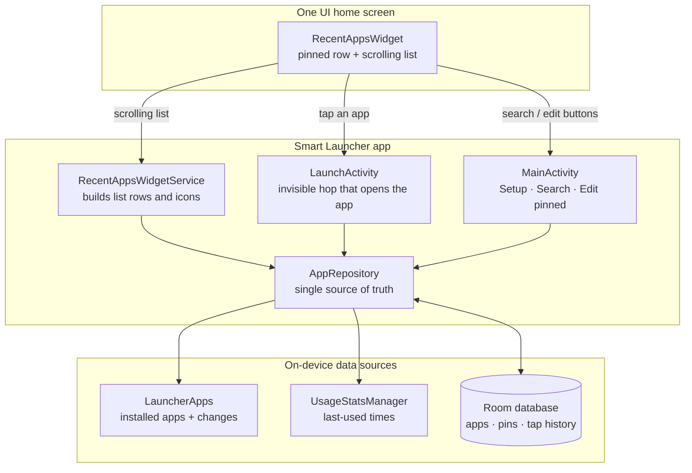
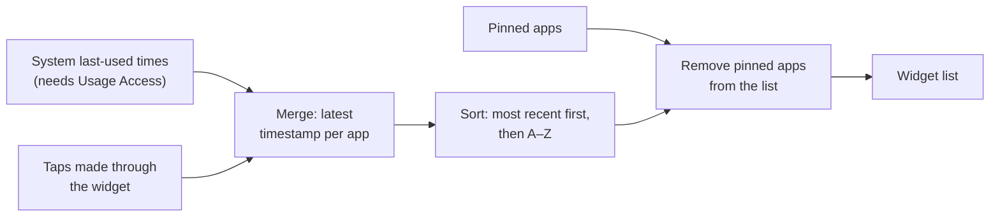
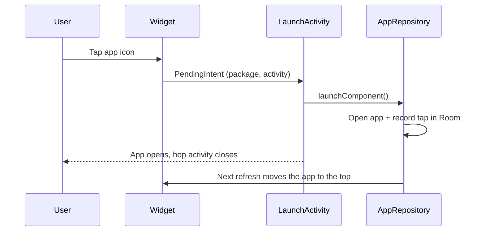

# Smart Launcher — App Organizer Widget

A privacy-first Android home-screen widget for the Samsung Galaxy S24. It keeps your stock One UI home screen untouched and adds one full-page widget: a **pinned row** of up to five favourite apps, then **every other app sorted by most recent use**. All data stays on the device — the APK has no internet permission.

**Stack:** Kotlin · Jetpack Compose · App Widgets (RemoteViews) · Room · DataStore · UsageStatsManager · GitHub Actions

> The project started as a full replacement launcher (v0.1 MVP). It now ships as a widget so the One UI home screen stays as it is. The original launcher design is kept in [docs/DESIGN.md](docs/DESIGN.md) for reference.

---

## Features

- **Pinned row** — up to 5 apps, reordered by drag and drop on the *Edit pinned apps* screen
- **Recent-first list** — every launchable app, most recently used at the top; never-used apps at the end, A–Z
- **Search** — a search button in the widget opens a fast app search
- **Works without permissions** — without Usage Access it learns from taps made through the widget
- **Private by design** — no `INTERNET` permission, no telemetry, no backups leaving the phone

---

## Architecture (logical view)



### How the list is ordered



### Opening an app from the widget



---

## Project structure

```
app/src/main/java/com/apporganizer/launcher/
├── App.kt                   Application + manual dependency wiring
├── widget/                  Home-screen widget
│   ├── RecentAppsWidget.kt          AppWidgetProvider: pinned row, buttons, refresh
│   ├── RecentAppsWidgetService.kt   RemoteViewsFactory for the scrolling list
│   ├── LaunchActivity.kt            Opens the tapped app and records the tap
│   └── WidgetIcons.kt               Icon rendering for RemoteViews
├── ui/                      Compose screens
│   ├── MainActivity.kt              Setup, search and edit-pinned modes
│   ├── EditPinnedScreen.kt          Drag-and-drop pinned row editor
│   └── SystemIntents.kt             Shortcuts to system settings pages
├── data/                    Repository, Room, DataStore, system sources
└── domain/                  Pure Kotlin: categories, classifier, ranking (unit-tested)
app/src/test/                RankingEngineTest · ClassifierTest
docs/DESIGN.md               v0.1 launcher design document
```

---

## Build and install

**Requirements:** Android Studio Ladybug (2024.2) or newer with JDK 17+, Android SDK Platform 35, a phone on Android 10 or later (the S24 ships with Android 14).

### Cloud build (no computer needed)

Every push to `main` runs the **Build APK** GitHub Action: it builds a debug APK, runs the unit tests and publishes `SmartLauncher.apk` on the [Releases](../../releases) page. Download it on the phone and tap to install.

### Local build

```bash
./gradlew testDebugUnitTest      # ranking and classification unit tests
./gradlew assembleDebug          # app/build/outputs/apk/debug/app-debug.apk
adb install -r app/build/outputs/apk/debug/app-debug.apk
```

### Signed release build (optional)

```bash
mkdir -p release
keytool -genkeypair -v \
  -keystore release/apporganizer-release.jks \
  -alias apporganizer -keyalg RSA -keysize 4096 -validity 10000
cp keystore.properties.example keystore.properties   # fill in the passwords
./gradlew assembleRelease
```

`keystore.properties` and `*.jks` are git-ignored. Back up the keystore and passwords: without them you cannot update an installed release build.

### First run on the phone

1. Open **Smart Launcher** from the app list.
2. **Allow Usage Access** (optional — without it, only apps opened from the widget move to the top).
3. **Add the widget** to a home-screen page, then long-press it and drag the edges to make it full page.
4. **Pin your favourites** — tap the widget's edit button and drag up to five apps into the pinned row.

Samsung tip: Settings → Apps → Smart Launcher → Battery → **Unrestricted** keeps the widget fresh.

---

## Privacy

- `INTERNET` and `ACCESS_NETWORK_STATE` are force-removed from the merged manifest (`tools:node="remove"`), so no library can add network access.
- No telemetry, crash reporting or ad SDKs.
- `allowBackup=false` plus data-extraction rules block cloud backup and device-to-device transfer.
- Only app launch times are read — never notifications, messages, files or screen content.
- Verify with: `aapt2 dump permissions SmartLauncher.apk` — expect `PACKAGE_USAGE_STATS` and no `INTERNET`.
