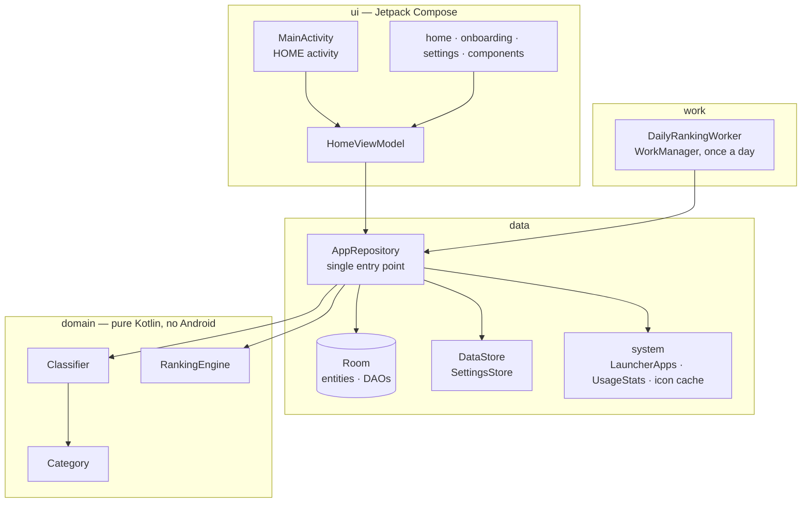
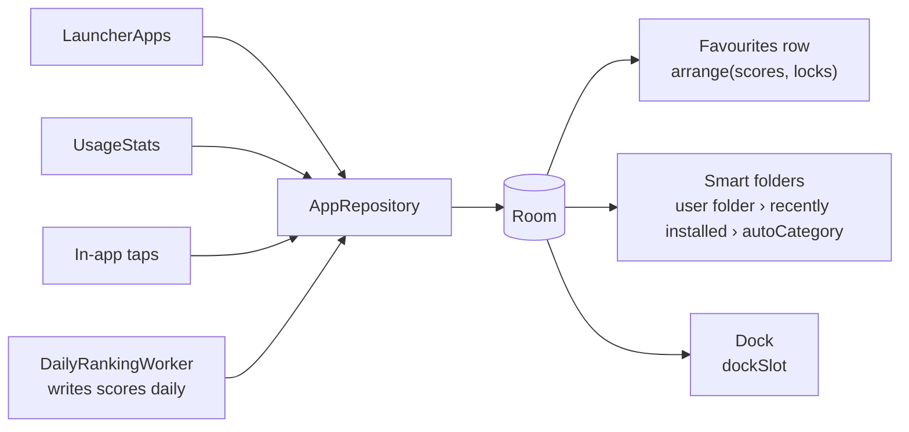
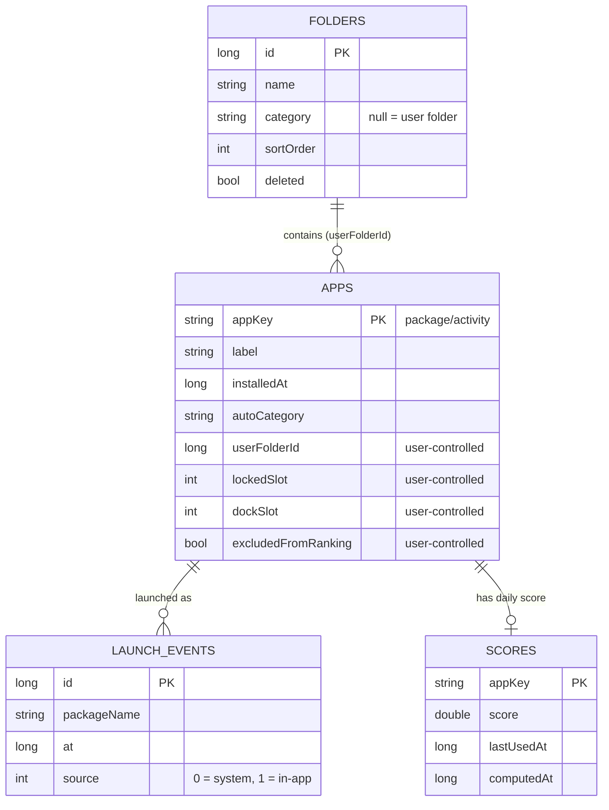
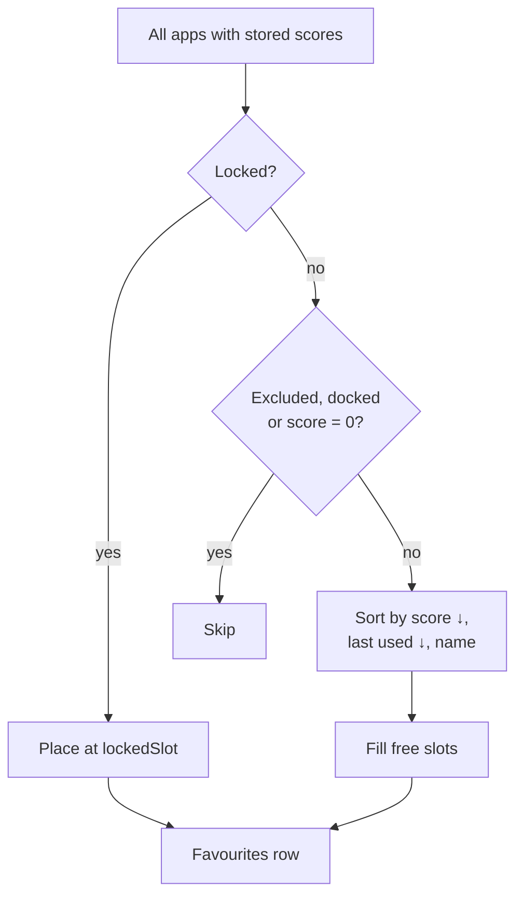
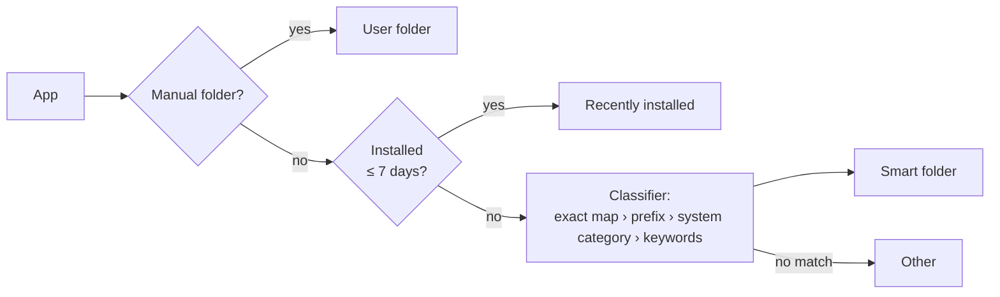

# Smart Launcher (App Organizer) — v0.1 Launcher Design

Version: 0.1.0-mvp · Target device: Samsung Galaxy S24 (One UI 6/7/8, Android 14–16)

> **Status:** this document describes the original v0.1 design, a full replacement launcher. The project has since moved to a home-screen widget that leaves One UI Home untouched (see the [README](../README.md)). The data layer, ranking engine and classifier described here are still in the codebase; the launcher UI (onboarding, home screen, daily WorkManager job) has been retired.

---

## 1. Reference project review

Data from the GitHub repository pages, reviewed 2026-10-12. Last-commit dates were not shown, so activity is estimated from commits, stars and maintenance status.

| Project | License | Size / activity | Stack | Worth borrowing | Can the code be reused? |
|---|---|---|---|---|---|
| **Ratio Launcher** | **No license** (README says "independent recreation, for learning") | 1★, 78 commits, solo, has CI | Kotlin, single `app` module, minSdk 26 / SDK 36 | Auto-categorised drawer, custom categories, dock, backup/restore | **No.** No license = all rights reserved; a fork cannot be distributed legally |
| **Lawnchair** | GPL-3.0 (based on Apache-2.0 AOSP Launcher3) | 13.5k★, 1.7k forks, very active | Kotlin + Java, Launcher3 fork, mixed Soong/Gradle, systemui/wmshell submodules | Mature home architecture, icon grid, folders, drag and drop, icon packs | Yes, but the whole project must be GPL-3.0; the `16-dev` branch is marked unstable |
| **android-app-organizer** | MIT | 1★, 1 commit | Python + UIAutomator2/ADB + Kotlin helper | Classification rules, dry-run/rollback design | Ideas only; dragging One UI icons over ADB conflicts with this project's principles |
| **Slate Minimal Launcher** | MIT | 29★, 141 commits | Android / Gradle KTS | Usage-count ordering, pinning, hidden apps | Yes (keep the copyright notice) |
| **FuseLauncher** | MIT | 9★, 35 commits | **Flutter** | Usage-frequency ranking with decay | Concept only; different language |
| **LaunchTime** | GPL-3.0 | 82★, 1,014 commits | Android / Java | Auto-classification on first run and on install, user corrections | Copying code would make the project GPL |
| **Apps2Org** | No license | 15★, 190 commits, old Ant project | Java | Multi-label classification model | Concepts only |

### Decision: build from scratch in Compose, borrow ideas, do not fork

| Option | Pros | Main problems |
|---|---|---|
| Fork Ratio Launcher | Closest feature set | **No license — cannot be forked and distributed**; single maintainer |
| Fork Lawnchair | Most complete home experience | Huge codebase (87k commits), yearly AOSP merges, GPL-3.0, AOSP prebuilt dependencies; adding daily ranking and smart folders means deep changes to Launcher3's Workspace/Model layers — too costly for an MVP |
| **Build from scratch (chosen)** | Fully owned code, any license; small Compose codebase (~2.6k lines of Kotlin); architecture fits "one data source drives home, favourites and folders" | Drag and drop, widgets and icon packs must be built later |

---

## 2. Architecture and modules

The MVP uses a **single `:app` module with layered packages** to keep Gradle simple; package boundaries map one-to-one to future modules.



### Data flow (single source of truth)



Suggested split from v0.3 onwards, when the team or codebase grows: `:core:domain` (pure JVM), `:core:data`, `:core:work`, `:feature:home`, `:feature:onboarding`, `:feature:settings`, `:app`.

---

## 3. Room schema



| Table | Notes |
|---|---|
| `apps` | One row per launchable activity. The four user-controlled fields are always preserved on rescan. |
| `folders` | Non-null `category` = smart folder; null = user-created. Deleting a smart folder only sets `deleted`, so a rescan does not bring it back. |
| `launch_events` | Raw launch events, unique on (packageName, at, source) to prevent duplicates; kept for 35 days. |
| `scores` | **Daily score snapshot.** The home screen reads only this snapshot, so unlocked icons do not move during the day. |

Why raw events instead of daily totals: system UsageStats keeps events for only a few days, and the 24-hour window needs exact timestamps. That is roughly 50–300 rows a day — a few thousand over 30 days.

DataStore keys: `onboarding_done`, `layout_mode`, `auto_adjust`, `last_ranking_at`, `last_ingest_at`, `dock_initialized`.

---

## 4. Ranking algorithm

```
score          = 5 × launches(24h) + 2 × launches(7d) + 0.5 × launches(30d) + recency bonus
recency bonus  = 6 × 0.5^(hours since last use / 24)      # halves every 24 h, max 6
stability      = apps already in yesterday's favourites × 1.10   # stops borderline apps flipping
```

The windows overlap on purpose (today's launch counts in the 24h, 7d and 30d windows), so recent behaviour weighs most: one launch today ≈ 7.5 points, one launch 25 days ago ≈ 0.5, and old apps cannot dominate forever.

**What counts as one launch:** an `ACTIVITY_RESUMED` event whose package differs from the previous foreground package. Moving between screens inside one app is not counted again; returning to the same app after a screen lock counts as new.

**Arranging the favourites row** (`RankingEngine.arrange`):
1. Locked apps go to their `lockedSlot` (locks beyond the current layout size are ignored).
2. Remaining slots are filled by score, descending; ties broken by last use, then name.
3. Excluded, docked and zero-score apps are never auto-placed.



**Timing:** WorkManager runs around 4 a.m. daily (sync apps → ingest events → recompute scores). Samsung may delay background work, so opening the home screen recomputes in the foreground when the last run is more than 26 hours old. Turning off "auto adjust" freezes scores.

**Fallback:** without Usage Access, only in-app taps (source = 1) are used and the home screen shows an "in-app learning mode" label.

---

## 5. Automatic classification

Priority (high → low):

1. **Manual user choice** (`userFolderId`) — never overwritten; cleared only by "Reset classification"
2. Exact package map (~70 common apps, including Malaysian favourites such as Shopee, Lazada, Grab, TNG eWallet and Maybank)
3. Package prefixes (`com.microsoft.office*`, `com.maybank2u*`, `com.cimb*`, …)
4. `FLAG_IS_GAME` / `ApplicationInfo.category` (GAME → Games; AUDIO/VIDEO/IMAGE/NEWS → Media; SOCIAL → Communication; MAPS → Travel; PRODUCTIVITY → Work; ACCESSIBILITY → Tools)
5. Keywords in package name + label, English and Chinese: English words of 3 letters or fewer match whole words only (so `tv` does not hit `activity`); Chinese keywords match as substrings. Order: Finance → Communication → Work → Shopping → Travel → Media → Games → Tools; first hit wins
6. Other



---

## 6. Permissions and fallbacks

| Permission | Purpose | If declined |
|---|---|---|
| Usage Access (`PACKAGE_USAGE_STATS`, enabled by the user in system settings) | Launch counts and last-used times | In-app learning mode: only taps inside the launcher count |
| ROLE_HOME (RoleManager) | Become the default home app | Still usable as a normal app; can be requested again from settings |
| `<queries>` for LAUNCHER / DIAL / IMAGE_CAPTURE / VIEW https / WhatsApp | Android 11+ package visibility for launchable apps and the default dock | Not a runtime permission |

**Explicitly not requested:** Accessibility, Contacts, SMS, storage, overlay, location, `QUERY_ALL_PACKAGES`.
**`INTERNET` is force-removed from the merged manifest** with `tools:node="remove"`, so no dependency can add network access.
`allowBackup=false` plus `data_extraction_rules` block cloud backup and device-to-device transfer; data never leaves the phone.

---

## 7. MVP scope checklist (v0.1 launcher)

| Requirement | Status |
|---|---|
| Six-screen onboarding | ✅ Welcome / permission / scan / layout / default home / done |
| Request Usage Access with explanation; can be declined | ✅ |
| Request default launcher role (RoleManager) | ✅ |
| Read launchable apps and watch installs/uninstalls | ✅ LauncherApps + callback |
| 8 dynamic favourites (layout 4 / 8 / 12) | ✅ |
| Auto-created category folders + "Recently installed" | ✅ |
| Lock position, move to folder, exclude from ranking, dock add/remove | ✅ Long-press menu |
| Create / rename / delete folders | ✅ |
| Reset classification, rescan | ✅ Settings |
| Recompute once a day | ✅ WorkManager + foreground catch-up |
| Guide back to One UI Home | ✅ Onboarding finish screen + settings |

**Known MVP limits:** no drag-and-drop ordering; work profile / Secure Folder apps not shown; no widget; folder contents ordered by score only.

---

## 8. S24 device test checklist

1. Install → onboarding → decline Usage Access → home shows "in-app learning mode"
2. Settings → grant access → return; the label disappears and favourites fill after "Reorganize now"
3. Set as default home, press Home; open a folder and press Home — the folder closes
4. Long-press a favourite → Lock → position is unchanged after "Reorganize now"
5. Move an app to a custom folder → it stays there after "Rescan apps"
6. Install a new app → it appears in "Recently installed"
7. Settings → Switch back to One UI Home → choose One UI Home and confirm it is restored
8. Settings → Battery → set the app to "Unrestricted"; check that it reorders after 4 a.m. the next day
9. Confirm with `aapt2 dump permissions` or the Android Studio APK Analyzer that the APK has **no** INTERNET permission

---

## 9. Roadmap at the time

- v0.2: drag-and-drop ordering, manual order inside folders, icon packs, local JSON export/import backup
- v0.3: work profile (`LauncherApps.getProfiles()`), widget, module split
- Optional (separate toggle + privacy notice): online classification, weather

The widget direction from v0.3 became the product: see the README for the current design.
